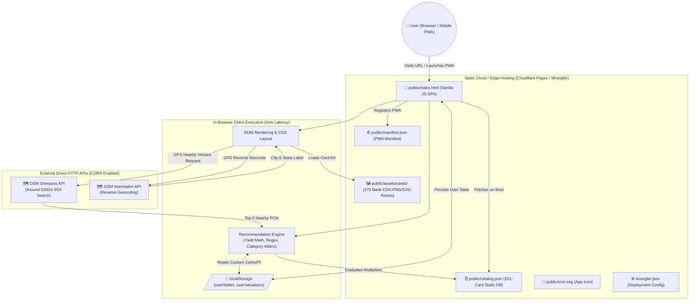

# Workspace Rules

## Clean Up Temporary Scripts
Whenever you create temporary scripts (like `fix_xyz.py`, `test.py`, `parse.js`, etc.) to modify code, analyze data, or run tests, you MUST delete them immediately after you are finished using them. 

Do not leave them cluttering the project directory. Only retain scripts if they are intended to be reused as part of the project's permanent workflow (in which case, they should be placed in the `scripts/` directory).

## Local Javascript Verification
If you make changes to the Javascript engine inside `public/index.html`, you MUST test the syntax locally before you commit and push to production. 
Because Node.js is not installed on this machine, you must use macOS's built-in Javascript engine via the terminal:
```bash
osascript -l JavaScript -e "$(cat public/index.html | grep -o '<script>.*</script>' || awk '/<script>/{flag=1; next} /<\/script>/{flag=0} flag')"
```
If it throws `ReferenceError: Can't find variable: window` (or `setInterval`), it means the JavaScript syntax successfully parsed without syntax errors.

---

# OptiRewards: Technical Architecture & System Blueprint

> **Target Audience:** Autonomous AI Agents, LLM Code Assistants, and Systems Engineers.  
> **Purpose:** This document provides the rigorous architectural, logic, data, algorithmic, and UI specifications required to replicate the entire OptiRewards codebase from scratch without referencing the original source code.

---

## 1. System Architecture & Hosting

OptiRewards operates as a **100% Serverless, Client-Side Single Page Application (SPA)**. It relies entirely on static file hosting for 0ms computation latency, instant offline capabilities, and complete zero-knowledge privacy.



### 1.1 Complete Repository File Inventory
```
OptiRewards/
├── ARCHITECTURE.md                  # Comprehensive AI System Blueprint (this document)
├── README.md                        # User documentation, feature walkthrough, and setup guide
├── wrangler.json                    # Cloudflare Pages / Workers static assets deployment config
├── .gitignore                       # Git ignore rules for scratch scripts, local zips, python caches
├── public/                          # Web root served directly to users
│   ├── index.html                   # Monolithic SPA (HTML5, CSS3, Vanilla JavaScript, 1,370 lines)
│   ├── catalog.json                 # Static JSON database (201 active cards, calendars, merchant regexes, 356 KB; metadata header states legacy 199)
│   ├── manifest.json                # PWA configuration manifest
│   ├── icon.svg                     # High-resolution vector icon for PWA install and favicon
│   └── assets/
│       └── cards/                   # Authentic card artwork assets (379 PNG and SVG files)
└── scripts/                         # Maintenance and local execution utilities
    ├── download_all_official_cards.py # Asset scraper downloading official card art from bank CDNs
    └── serve.py                     # Zero-dependency Python HTTP server (runs on port 8085)
```

### 1.2 Deployment Configuration (`wrangler.json`)
The application is pre-configured for Cloudflare Pages / Workers Static Assets:
```json
{
  "name": "optirewards-app",
  "compatibility_date": "2026-09-10",
  "assets": {
    "directory": "public"
  }
}
```
Routing all inbound requests directly to the `public/` directory with zero build steps, zero transpilation, and zero server-side middleware.

### 1.3 Zero Build Step & PWA Standards
- **No Node.js / NPM Build Step:** The application has no `package.json`, Webpack, Babel, Vite, or framework dependencies. All execution is standard browser ECMAScript 6+ and CSS3.
- **PWA Requirements:** `public/index.html` implements standard PWA headers:
  ```html
  <link rel="manifest" href="manifest.json">
  <meta name="apple-mobile-web-app-capable" content="yes">
  <meta name="apple-mobile-web-app-status-bar-style" content="black-translucent">
  <meta name="theme-color" content="#000000">
  <meta name="viewport" content="width=device-width, initial-scale=1.0, viewport-fit=cover, user-scalable=no">
  <link rel="icon" type="image/svg+xml" href="icon.svg">
  <link rel="apple-touch-icon" href="icon.svg">
  ```
- **PWA Manifest (`public/manifest.json`):**
  ```json
  {
    "name": "OptiRewards",
    "short_name": "OptiRewards",
    "start_url": "/index.html",
    "display": "standalone",
    "background_color": "#000000",
    "theme_color": "#000000",
    "description": "Optimize your credit card rewards.",
    "icons": [
      {
        "src": "icon.svg",
        "sizes": "192x192 512x512",
        "type": "image/svg+xml",
        "purpose": "any maskable"
      }
    ]
  }
  ```

### 1.4 External Direct APIs
1. **OSM Nominatim Reverse Geocoding:**
   - **Endpoint:** `https://nominatim.openstreetmap.org/reverse?format=json&lat=${lat}&lon=${lng}`
   - **Method:** `GET` (CORS enabled)
   - **Payload Extraction:** Reads `address.city || address.town || address.village || address.county || "Your Location"` and `address.state`.
2. **OSM Overpass API POI Discovery:**
   - **Endpoint:** `https://overpass-api.de/api/interpreter?data=${encodeURIComponent(query)}`
   - **Method:** `GET` (CORS enabled)
   - **Search Radius:** 5,000 meters surrounding user GPS coordinates.

---

## 2. Data Models & State Schemas

### 2.1 Static Database Schema (`public/catalog.json`)
The catalog is structured into four primary sections: `metadata`, `quarterly_calendars`, `merchant_mappings`, and `cards`.

```json
{
  "metadata": {
    "version": "1.0",
    "card_count": 199, // Note: legacy header value; the cards array contains 201 active cards
    "description": "OptiRewards Card Catalog - Edit this file to update cards or rules."
  },
  "quarterly_calendars": {
    "discover_it_cash_back": {
      "Q1": ["restaurants", "drugstores"],
      "Q2": ["gas_stations", "home_improvement", "public_transit"],
      "Q3": ["gas_stations", "public_transit", "pharmacies"],
      "Q4": ["amazon", "target"]
    },
    "chase_freedom_flex": {
      "Q1": ["groceries", "fitness", "spa"],
      "Q2": ["hotels", "restaurants", "amazon"],
      "Q3": ["gas_stations", "public_transit", "live_entertainment"],
      "Q4": ["paypal", "wholesale_clubs", "charity"]
    },
    "us_bank_cash_plus": {
      "Q1": ["utilities", "fast_food", "cell_phone", "department_stores", "electronics", "gyms"],
      "Q2": ["utilities", "fast_food", "cell_phone", "department_stores", "electronics", "gyms"],
      "Q3": ["utilities", "fast_food", "cell_phone", "department_stores", "electronics", "gyms"],
      "Q4": ["utilities", "fast_food", "cell_phone", "department_stores", "electronics", "gyms"]
    },
    "chase_freedom_original": {
      "Q1": ["groceries", "fitness", "spa"],
      "Q2": ["hotels", "restaurants", "amazon"],
      "Q3": ["gas_stations", "public_transit", "live_entertainment"],
      "Q4": ["paypal", "wholesale_clubs", "charity"]
    }
  },
  "merchant_mappings": [
    {
      "id": "m_0",
      "merchant_name": "Kroger Family",
      "merchant_pattern": "kroger|ralphs|dillons|smith'?s|fred.?meyer|fry'?s|qfc|harris.?teeter|king.?soopers|marianos|pick.?n.?save",
      "category_key": "groceries",
      "brand_icon": "store"
    },
    {
      "id": "m_1",
      "merchant_name": "Costco",
      "merchant_pattern": "costco",
      "category_key": "wholesale_clubs",
      "brand_icon": "store"
    }
  ],
  "cards": [
    {
      "id": "chase_sapphire_reserve",
      "issuer_id": "chase",
      "name": "Chase Sapphire Reserve®",
      "slug": "chase-sapphire-reserve",
      "network": "Visa Infinite",
      "card_type": "personal",
      "annual_fee": 550,
      "foreign_tx_fee": 0,
      "credit_tier": "Excellent",
      "apply_url": "https://creditcards.chase.com/rewards-credit-cards/sapphire/reserve",
      "image_url": "https://creditcards.chase.com/content/dam/jpmc-marketplace/card-art/sapphire_reserve_card.png",
      "local_image_path": "assets/cards/chase-sapphire-reserve.png",
      "is_active": true,
      "currency_type": "points",
      "currency_name": "Ultimate Rewards",
      "base_rate": 1.0,
      "point_valuation_cents": 1.8,
      "welcome_bonus_desc": "60,000 points after $4,000 spend in first 3 months",
      "categories": [
        {
          "category_key": "travel",
          "category_name": "Travel",
          "multiplier": 3.0,
          "spend_cap": null,
          "cap_period": null,
          "is_rotating": false,
          "rotating_quarter": null,
          "notes": "3x on general travel purchases worldwide"
        },
        {
          "category_key": "dining",
          "category_name": "Dining",
          "multiplier": 3.0,
          "spend_cap": null,
          "cap_period": null,
          "is_rotating": false,
          "rotating_quarter": null,
          "notes": "3x on dining at restaurants including eligible delivery services"
        }
      ],
      "benefits": [
        "$300 Annual Travel Credit",
        "Priority Pass™ Select Lounge Membership",
        "Global Entry, TSA PreCheck® or NEXUS Fee Credit",
        "1:1 Point Transfer to Airline & Hotel Partners"
      ],
      "created_at": "2026-09-10T00:00:00Z",
      "updated_at": "2026-09-10T00:00:00Z"
    }
  ]
}
```

### 2.2 Local Storage Schemas (`localStorage`)
All state persistence is client-side. The app interacts with two persistent keys:
1. `userWallet`: JSON array of full card objects. Cards added by the user in the Wallet tab are serialized here in their exact prioritized index order:
   ```json
   [
     {
       "id": "chase_sapphire_reserve",
       "name": "Chase Sapphire Reserve®",
       "issuer_id": "chase",
       "network": "Visa Infinite",
       "currency_name": "Ultimate Rewards",
       "base_rate": 1.0,
       "point_valuation_cents": 1.8,
       "categories": [...]
     }
   ]
   ```
2. `userValuations`: JSON object mapping reward program currency names to floating-point cents-per-point values:
   ```json
   {
     "Ultimate Rewards": 2.0,
     "Membership Rewards": 2.0,
     "Capital One Miles": 1.8,
     "Bilt Rewards": 2.2,
     "ThankYou Points": 1.8,
     "Hilton Honors": 0.5,
     "Marriott Bonvoy": 0.8,
     "IHG One Rewards": 0.5
   }
   ```

### 2.3 In-Memory UI State Variables
State is held globally within `public/index.html`:
```javascript
let catalog = null;                 // Parsed content of public/catalog.json
let allCards = [];                  // Reference to catalog.cards (201 objects; legacy metadata states 199)
let userWallet = [];                // Loaded from localStorage.getItem('userWallet')
let userValuations = {};            // Loaded from localStorage.getItem('userValuations')
let nearbyStores = [];              // Populated by Overpass API (top 5 closest POIs)
let currentTab = 'instore';         // 'instore' | 'online' | 'valuations' | 'wallet'
let locationName = 'Locating...';   // Set by Nominatim reverse geocoding
let gpsLoaded = false;              // True once Geolocation & Overpass resolve
let currentRecommendation = null;   // Active recommendation object or null
let walletSearchQuery = '';         // Current search string in Wallet tab
let selectedIssuerFilter = 'all';   // 'all' | 'in_wallet' | 'chase' | 'amex' | ...
let selectedRewardFilter = 'all';   // 'all' | 'cash' | 'points'
let selectedFeeFilter = 'all';      // 'all' | 'no_fee' | 'has_fee'
let selectedNetworkFilter = 'all';  // 'all' | 'visa' | 'mastercard' | 'american express' | 'discover'
let selectedTypeFilter = 'all';     // 'all' | 'personal' | 'business'
let activeExpandedCardId = null;    // Card ID whose details drawer is currently expanded
window.activeSearchQuery = '';      // Active input ID for focus retention ('instore_search' | 'online_search')
```

---

## 3. Core Algorithms & Recommendation Engine

The core recommendation engine resides in `getLocalRecommendation(query, forcedCatKey)` in `public/index.html`.

### 3.1 Merchant Resolution & Keyword Heuristics
When an evaluation is triggered:
1. **Direct Regex Matching:** Matches `query` against `catalog.merchant_mappings`:
   ```javascript
   let categoryKey = 'general';
   let merchantName = null;
   const qLower = query.toLowerCase();

   for (let m of catalog.merchant_mappings) {
     try {
       const regex = new RegExp(m.merchant_pattern, 'i');
       if (regex.test(query) || qLower.includes(m.merchant_name.toLowerCase())) {
         categoryKey = m.category_key;
         merchantName = m.merchant_name;
         break;
       }
     } catch(e) {}
   }
   ```
2. **Forced Category & Keyword Heuristics Fallback:**
   If `categoryKey === 'general'`:
   - If `forcedCatKey` is passed (e.g. from a POI tap or category button), `categoryKey = forcedCatKey`.
   - Otherwise, keyword heuristics scan `qLower`:
     - `grocery`, `supermarket`, `kroger`, `food lion`, `safeway`, `publix`, `wegmans`, `aldi`, `trader joe`, `heb` $\to$ `'groceries'`
     - `restaurant`, `cafe`, `food`, `dining`, `burger`, `pizza`, `sushi`, `steak`, `taco`, `mcdonald`, `starbucks`, `wendy`, `chipotle`, `chick-fil` $\to$ `'dining'`
     - `gas`, `fuel`, `shell`, `chevron`, `exxon`, `bp`, `mobil`, `speedway`, `wawa` $\to$ `'gas_stations'`
     - `airline`, `flight`, `airways`, `delta`, `united`, `american`, `southwest` $\to$ `'travel'`
     - `hotel`, `motel`, `resort`, `marriott`, `hilton`, `hyatt` $\to$ `'hotels'`
     - `uber`, `lyft` $\to$ `'rideshare'`
     - Default fallback: `categoryKey = query` (literal string passed to equivalency matcher).

### 3.2 Category Equivalency Matrix (`isCategoryMatch`)
Category matching uses a 10-group bidirectional equivalence matrix plus prefix matching:
```javascript
function isCategoryMatch(c, q) {
  if (!c || !q) return false;
  c = c.toLowerCase();
  q = q.toLowerCase();
  if (c === q) return true;
  if (c === 'all' || c === 'general') return true;
  
  const groups = [
    ['restaurants', 'dining', 'food_delivery', 'food'],
    ['groceries', 'supermarket', 'grocery_delivery'],
    ['gas_stations', 'gas'],
    ['flights', 'airfare', 'travel'],
    ['hotels', 'travel'],
    ['travel_portal', 'travel'],
    ['rental_cars', 'travel'],
    ['public_transit', 'transit', 'travel'],
    ['rideshare', 'transit', 'travel'],
    ['online_shopping', 'shopping']
  ];
  
  for (let grp of groups) {
    if (grp.includes(c) && grp.includes(q)) return true;
  }
  
  if (c.startsWith(q) || q.startsWith(c)) return true;
  
  return false;
}
```

### 3.3 Active Candidate Pool & Simulated Wallet Mode
```javascript
let candidateCards = userWallet;
let isSimulated = false;

// If user hasn't configured a wallet yet, evaluate across all 201 active catalog cards (legacy metadata states 199)
if (!candidateCards || candidateCards.length === 0) {
  candidateCards = catalog.cards.filter(c => c.is_active);
  isSimulated = true;
}
```

### 3.4 Rotating Quarter Formula & Evaluation
Cards with `cat.is_rotating || cat.category_key === 'rotating_bonus'` check `catalog.quarterly_calendars`:
- **Current Quarter Formula:**
  $$\text{currentQuarter} = \text{"Q"} + \operatorname{Math.ceil}\left(\frac{\text{new Date().getMonth()} + 1}{3}\right)$$
- If `catalog.quarterly_calendars[card.id][currentQuarter]` contains any category `vq` where `isCategoryMatch(vq, categoryKey)` is true, the multiplier is upgraded to `cat.multiplier` (typically 5.0) and flagged as rotating.

### 3.5 Effective Yield Formula & Valuation Math
```javascript
const valCents = (userValuations && userValuations[card.currency_name] !== undefined)
  ? parseFloat(userValuations[card.currency_name])
  : (parseFloat(card.point_valuation_cents) || 1.0);

let yieldPct = multiplier * (valCents / 1.0);
yieldPct = Math.round(yieldPct * 100) / 100;
```
$$\text{Effective Yield (\%)} = \text{Multiplier} \times \text{Valuation Cents}$$

### 3.6 Costco Visa Restriction Constraint
Costco warehouses exclusively accept Visa credit cards. If the query references Costco, non-Visa cards are disqualified:
```javascript
if (query.toLowerCase().includes('costco') && card.network && !card.network.toLowerCase().includes('visa')) {
  isAccepted = false;
  yieldPct = 0.0;
  appliedRuleFinal = "Not accepted (Costco only takes Visa)";
}
```

### 3.7 Sorting & Tie-Breaker Logic
Cards are sorted descending by `effective_yield_pct`. When yields match within 0.001%, the tie is broken strictly by the card's index position in `userWallet`:
```javascript
scored.sort((a, b) => {
  if (Math.abs(b.effective_yield_pct - a.effective_yield_pct) > 0.001) {
    return b.effective_yield_pct - a.effective_yield_pct;
  }
  const idxA = userWallet.findIndex(c => c.id === a.card_id);
  const idxB = userWallet.findIndex(c => c.id === b.card_id);
  const rankA = idxA >= 0 ? (userWallet.length - idxA) : 0;
  const rankB = idxB >= 0 ? (userWallet.length - idxB) : 0;
  return rankB - rankA;
});
```
Cards placed higher (lower array index) in the active wallet always win tie-breakers. Cards not in the wallet receive rank 0.

### 3.8 Output Structure & Recommendation Presentation (Top 3)
`getLocalRecommendation` returns:
```javascript
return {
  query: query,
  resolved_category: categoryKey,
  merchant_name: merchantName,
  is_simulated_wallet: isSimulated,
  best_card: scored[0],
  runner_ups: scored.slice(1, 3)
};
```
- **#1 Best Card:** Renders full card art (``), high-contrast green yield badge (`${best.effective_yield_pct}% Yield`), card name, applied multiplier rule, and point valuation details.
- **#2 and #3 Runner-Ups:** Displayed in a compact, text-only sub-list below the primary card without images to preserve screen real estate. Formatted as: `${card.card_name} — ${card.effective_yield_pct}% (${card.multiplier}x)`.

### 3.9 Category Toggle Dismissal Behavior
Tapping an active category button or POI a second time toggles off and closes the recommendation container:
```javascript
if (currentRecommendation && currentRecommendation.query === query) {
  currentRecommendation = null;
  render();
  return;
}
```

### 3.10 Wholesale Clubs Split View (`wholesale_clubs_split`)
Tapping the Wholesale Clubs category triggers a special split query producing a multi-recommendation state container:
```javascript
// State construction: public/index.html lines 641-650
if (query === 'wholesale_clubs_split') {
  currentRecommendation = {
    query: query,
    is_multi: true,
    subs: [
      { title: 'Costco (Visa Only)', rec: getLocalRecommendation('Costco') },
      { title: "Sam's Club", rec: getLocalRecommendation("Sam's Club") },
      { title: "BJ's Wholesale", rec: getLocalRecommendation("BJ's Wholesale") }
    ]
  };
}
```

The recommendation renderer inspects `currentRecommendation.is_multi` and dynamically maps over `subs`, invoking `renderSingleRec(sub.rec, sub.title)`:
```javascript
// DOM rendering snippet: public/index.html lines 749-755
if (currentRecommendation.is_multi) {
  let html = '<div id="rec-box-anchor" style="display:flex; flex-direction:column; gap:12px; margin-top:10px;">';
  for (let sub of currentRecommendation.subs) {
    html += renderSingleRec(sub.rec, sub.title);
  }
  html += '</div>';
  return html;
}
```
This renders three stacked recommendation cards concurrently inside `#rec-box-anchor`, each respecting merchant-specific acceptance constraints (Costco enforces Visa-only acceptance; Sam's Club and BJ's accept Mastercard, Amex, Visa, and Discover).

---

## 4. Geolocation & Overpass POI Pipeline

The In-Store tab features automated physical merchant discovery via browser Geolocation and OpenStreetMap.

```mermaid
sequenceDiagram
    autonumber
    actor User
    participant Browser as Browser Geolocation
    participant Nominatim as OSM Nominatim API
    participant Overpass as OSM Overpass API
    participant Engine as Recommendation Engine
    participant UI as DOM View

    User->>UI: Taps "Use My GPS"
    UI->>Browser: getCurrentPosition({timeout: 5000, enableHighAccuracy: true})
    Browser-->>UI: Returns (lat, lng)
    
    par Reverse Geocode Location
        UI->>Nominatim: GET /reverse?lat={lat}&lon={lng}
        Nominatim-->>UI: Returns City, State
        UI->>UI: Update #location-badge text
    and Query Nearby Merchants
        UI->>Overpass: GET /interpreter?data=[out:json];(nwr["amenity"...](around:5000...);...);out center 30;
        Overpass-->>UI: Returns Raw Nodes & Ways
    end
    
    UI->>UI: Compute Haversine distance for each node
    UI->>UI: Map OSM tags to category_key (dining, groceries, wholesale, shopping)
    UI->>UI: Sort by distance ascending & deduplicate by name
    UI->>UI: Slice closest 5 unique venues (nearbyStores)
    UI->>UI: Render 5 POI Chips
    
    User->>UI: Taps a nearby store chip (e.g. "Trader Joe's")
    UI->>Engine: getLocalRecommendation("Trader Joe's", "groceries")
    Engine-->>UI: Returns Top 3 Cards
    UI->>UI: Render Recommendation Box
```

### 4.1 Overpass QL Query Syntax
```text
[out:json];
(
  nwr["amenity"~"restaurant|fast_food|cafe"](around:5000,${lat},${lng});
  nwr["shop"~"supermarket|convenience|wholesale|department_store|clothes"](around:5000,${lat},${lng});
);
out center 30;
```

### 4.2 Haversine Distance Formula
Earth radius constant: $R = 3958.8\text{ miles}$.
$$\Delta\text{lat} = (\text{lat}_2 - \text{lat}_1) \times \frac{\pi}{180}, \quad \Delta\text{lon} = (\text{lon}_2 - \text{lon}_1) \times \frac{\pi}{180}$$
$$a = \sin^2\left(\frac{\Delta\text{lat}}{2}\right) + \cos\left(\text{lat}_1 \times \frac{\pi}{180}\right) \times \cos\left(\text{lat}_2 \times \frac{\pi}{180}\right) \times \sin^2\left(\frac{\Delta\text{lon}}{2}\right)$$
$$c = 2 \times \operatorname{atan2}\left(\sqrt{a}, \sqrt{1 - a}\right)$$
$$d = R \times c$$
Formatted to one decimal place: `d.toFixed(1) + ' mi'`.

### 4.3 OSM Tag Mapping & Deduplication
- `amenity` in `['restaurant', 'fast_food', 'cafe']` $\to$ `category: 'Dining'`, `catKey: 'dining'`
- `shop` in `['supermarket', 'convenience']` $\to$ `category: 'Groceries'`, `catKey: 'groceries'`
- `shop === 'wholesale'` $\to$ `category: 'Wholesale'`, `catKey: 'wholesale_clubs'`
- Other `shop` (e.g. `department_store`, `clothes`) $\to$ `category: 'Shopping'`, `catKey: 'online_shopping'`
- Results are sorted by `distanceNum` ascending, filtered via `seen = new Set()` on merchant name, and sliced to the top 5 unique venues.

---

## 5. UI / UX Layout & Component Specifications

### 5.1 Simulated Desktop iPhone Frame vs Mobile Responsive Overrides
- **Desktop Simulation (`> 768px`):**
  - Outer Frame: `.device-frame` with fixed `width: 430px`, `height: 900px`, `border-radius: 54px`, `border: 9px solid #222`, `box-shadow: 0 25px 60px rgba(0,0,0,0.5)`.
  - Dynamic Island: `.dynamic-island` centered at `width: 124px`, `height: 35px`, `border-radius: 20px`, containing camera sensor elements.
  - Status Bar: `.status-bar` (`height: 52px`) displaying real-time clock via `setInterval(updateTime, 1000)` and 5G / battery icons.
- **Mobile Responsive Mode (`@media (max-width: 768px)`):**
  ```css
  .device-frame {
    max-width: 100% !important;
    width: 100% !important;
    height: 100dvh !important;
    border-radius: 0 !important;
    border: none !important;
    box-shadow: none !important;
    padding-top: env(safe-area-inset-top) !important;
  }
  .dynamic-island, .status-bar {
    display: none !important;
  }
  /* Tab Bar Mobile Styling: public/index.html vs Target Specification */
  .tab-bar {
    /* Currently active in public/index.html:211-213 media query override: */
    padding: 6px 0 calc(6px + env(safe-area-inset-bottom)) 0 !important;
    
    /* Target specifications from ORIGINAL_REQUEST.md (2026-09-14) to protect icons from curved iPhone display corners: */
    align-items: flex-end !important;
    justify-content: center !important;
    gap: 28px !important;
  }
  ```
  *Critical Requirement:* Never use `position: fixed` for `.device-frame` or `.tab-bar` on iOS Safari. Use `position: absolute` within `100dvh`.

### 5.2 Focus & Scroll Position Preservation
Because `render()` reconstructs inner DOM elements, interactive state must be preserved:
1. **Input Focus & Caret Retention:**
   ```javascript
   const activeEl = document.activeElement;
   let activeInputId = null;
   let cursorStart = 0;
   let cursorEnd = 0;
   if (activeEl && (activeEl.tagName === 'INPUT' || activeEl.tagName === 'TEXTAREA')) {
     activeInputId = activeEl.id;
     cursorStart = activeEl.selectionStart;
     cursorEnd = activeEl.selectionEnd;
   }

   // DOM Update
   container.innerHTML = html;

   // Synchronous Focus Restoration
   if (activeInputId) {
     const restoredEl = document.getElementById(activeInputId);
     if (restoredEl) {
       restoredEl.focus();
       try { restoredEl.setSelectionRange(cursorStart, cursorEnd); } catch(e) {}
     }
   }
   ```
2. **Filter Ribbon Scroll Restoration:** Horizontal scroll positions (`scrollLeft`) of all `.filter-scroll` rows are cached before re-render and reapplied via `requestAnimationFrame`.

### 5.3 Touch & Mouse Drag-to-Reorder Engine (`initWalletDrag`)
Available when `selectedIssuerFilter === 'in_wallet'`:
- Handles `touchstart`, `touchmove`, `touchend` with `{ passive: false }` to block default page scrolling, and desktop `mousedown`, `mousemove`, `mouseup`.
- Active dragged element transforms with `scale(1.03) translateY(${dy}px)` and z-index elevation.
- Sibling cards shift dynamically:
  $$\Delta y > \frac{\text{height}}{2} \implies \text{sibling shifts } -\text{height}$$
  $$\Delta y < -\frac{\text{height}}{2} \implies \text{sibling shifts } +\text{height}$$
- On release, the dragged item is spliced into its new position in `userWallet`, persisted to `localStorage`, and re-rendered.

### 5.4 Expandable Card Details Drawer
Tapping anywhere on a card row (except the Add/Remove button or drag handle) toggles `activeExpandedCardId`:
- Slides open with CSS animation: `@keyframes slideDown { from { opacity: 0; transform: translateY(-8px); } to { opacity: 1; transform: translateY(0); } }`.
- **Annual Fee:** `$${card.annual_fee}` or `$0 (No Annual Fee)`.
- **Category Name Formatting:**
  - Underscores replaced with spaces.
  - Sentence-casing applied: `name.charAt(0).toUpperCase() + name.slice(1).toLowerCase()` (e.g. "Gas stations").
  - Any category denoting general spend (`all_purchases`, `base_rate`, `everyday`, `flat_rate`, `general`) is normalized strictly to `"Other"`.
- **Dynamic Base Rate Injection:** If `card.base_rate > 0` and the card lacks an explicit "Other" category in its JSON categories array, the drawer dynamically generates and displays an `"Other"` category with `card.base_rate` (e.g. "1.5% Other" or "1x Other").
- **Card Benefits:** Iterates through `card.benefits` and renders each with a `✨` prefix.
- **Card Art Two-Stage Fallback:** In `public/index.html` lines 1137 and 1225, card image elements implement a robust two-stage fallback:
  ```javascript
  const svgPath = '/' + card.local_image_path.replace('.png', '.svg');
  ```
  ```html
  
  ```
  1. *Stage 1 (SVG Swap):* If the primary PNG fails to load and `dataset.fallback` is unset, `this.dataset.fallback` is set to `'1'` and the source dynamically swaps to the vector SVG equivalent (`${svgPath}`).
  2. *Stage 2 (Graceful Degradation):* If the SVG asset is also unavailable or missing, `this.onerror` is nulled to halt recursive event firing and `this.style.opacity` is dimmed to `'0.3'`.

---

## 6. View Layer & Tab Specifications

### 6.1 Tab 1: In-Store (`instore`)
- **Header:** Location bar with GPS status (`📍 Richmond, VA` or `📍 Locating...`) and "Use My GPS" button.
- **Nearby Venues (POIs):** Horizontally scrollable list of closest 5 stores discovered via Overpass API. Tapping passes merchant name and `catKey` to `getLocalRecommendation`.
- **Search Bar:** Live text search with custom `✖` clear button and "Go" button.
- **Physical Category Taxonomy (9 Fixed Chips):**
  1. `🍽️ Dining & Restaurants` (`restaurants`)
  2. `🛒 Groceries` (`groceries`)
  3. `⛽ Gas Stations` (`gas_stations`)
  4. `⚡ EV Charging` (`ev_charging`)
  5. `🚆 Transit & Commuting` (`public_transit`)
  6. `📦 Wholesale Clubs` (`wholesale_clubs_split`)
  7. `💊 Drugstores & Pharmacies` (`pharmacies`)
  8. `🔨 Home Improvement` (`home_improvement`)
  9. `🚗 Rideshare` (`rideshare`)

### 6.2 Tab 2: Online (`online`)
- **Search Bar:** Live online merchant search.
- **Popular Digital Shortcuts (1-Tap Buttons):**
  - `Amazon.com` (passes query `'Amazon'`)
  - `Apple Store` (passes query `'Apple Store'`)
  - `Airlines (Delta / United / AA)` (passes query `'Delta Air Lines'`)

  *Merchant Regex Attribution Preservation:* In `public/index.html:849-854`, shortcuts invoke `renderPOI('Amazon', ...)`, `renderPOI('Apple Store', ...)`, and `renderPOI('Delta Air Lines', ...)`. Passing authentic merchant strings rather than raw category keys (`flights`) preserves merchant pattern matching against `catalog.merchant_mappings` (e.g. regex `delta` resolves `rec.merchant_name = "Delta Air Lines"` under category `flights`), ensuring airline-specific co-branded multipliers and authentic merchant labels are preserved.
- **Digital Spend Taxonomy (3 Categorized Sections):**
  - **✈️ Travel & Transit Apps:**
    - Flights & Airfare (`flights`)
    - Hotels & Lodging (`hotels`)
    - Bank Travel Portals (`travel_portal`)
    - Car Rentals (`rental_cars`)
    - Rideshare (Uber / Lyft) (`rideshare`)
  - **🛒 Online Shopping & Delivery:**
    - Amazon & Online Retailers (`amazon`)
    - Food Delivery (DoorDash / UberEats) (`food_delivery`)
    - Grocery Delivery (Instacart) (`grocery_delivery`)
    - Wholesale Clubs Online (`wholesale_clubs_split`)
    - Online Drugstores (`pharmacies`)
    - Home Improvement Online (`home_improvement`)
  - **📱 Digital Services & Subscriptions:**
    - Streaming Services (`streaming_video`)
    - Phone & Internet (`cell_phone`) — *Note: matches 5 bonus multiplier cards in `catalog.json` (`chase_ink_cash`, `us_bank_business_triple_cash`, `wells_fargo_business_platinum`, `us_bank_cash_plus`, `capital_one_spark_cash_select`); legacy key `phone_internet` has 0 matches*
    - Live Concerts & Events (`live_events`)
    - Digital Wallets (Apple Pay) (`digital_wallet`)

### 6.3 Tab 3: Point Values (`valuations`)
- **Valuation Presets:**
  - 🪙 **Cash Only (1.0¢):** Sets all valuations to `1.0¢`.
  - ✈️ **Standard Travel:** Hilton $\to$ `0.5¢`, Marriott $\to$ `0.8¢`, IHG $\to$ `0.5¢`, all others $\to$ `1.5¢`.
  - 👑 **Max Transfer Yield:** Ultimate Rewards $\to$ `2.2¢`, Membership Rewards $\to$ `2.0¢`, Capital One $\to$ `1.8¢`, Bilt $\to$ `2.2¢`, ThankYou Points $\to$ `1.8¢`.
- **Dynamic Active-Wallet Currency Filtering:**
  - Sliders are only rendered for currencies that are present in cards *actively enabled in `userWallet`*.
  - Currencies tied exclusively to cash back cards are hidden.
  - If no point-earning cards are in the wallet, renders an informative empty state: *"All Active Cards Earn Cash Back: All cards currently enabled in your wallet earn direct cash back (fixed at 1.0¢ = $0.01)"* with an "Open My Wallet" navigation button.
- **Interactive Slider Bounds:**
  - Hilton: min `0.3`, max `0.8`, step `0.05`
  - Marriott: min `0.5`, max `1.2`, step `0.1`
  - IHG: min `0.4`, max `0.9`, step `0.1`
  - Default / Other: min `1.0`, max `2.5`, step `0.1`

### 6.4 Tab 4: Wallet (`wallet`)
- **Search Input:** Filters cards by name, issuer, network, or currency.
- **5 Multi-Facet Filter Ribbons:**
  1. **Bank / Issuer:** 10 dynamic filter pills rendered based on issuer card count threshold (`count >= 10 || ['chase', 'amex', 'citi', 'capital_one', 'bofa', 'wells_fargo'].includes(id)`):
     - `All (202)` (`all`): All active cards in catalog
     - `✓ Active (N)` (`in_wallet`): Dynamic count of cards currently enabled in user wallet
     - `Chase (46)` (`chase`): JPMorgan Chase portfolio
     - `Amex (24)` (`amex`): American Express consumer & business portfolio
     - `Capital One (40)` (`capital_one`): Capital One branded cards (35) plus mapped Discover cards (5)
     - `Citi (29)` (`citi`): Citigroup portfolio
     - `BofA (22)` (`bofa`): Bank of America portfolio (short title `BofA`)
     - `Wells Fargo (9)` (`wells_fargo`): Wells Fargo branded cards (8) plus Bilt Mastercard (1)
     - `U.S. Bank (17)` (`us_bank`): U.S. Bank consumer & business portfolio (qualifies via count >= 10)
     - `Other (14)` (`other`): Aggregates Credit Unions (6), Synchrony Financial (4), Barclays US (2), Apple/Goldman Sachs (1), and Fidelity (1)
  2. **Reward Program:** All, Cash Back (`cash`), Points & Miles (`points`).
  3. **Annual Fee:** All Fees (`all`), No Annual Fee (`no_fee`), With Annual Fee (`has_fee`).
  4. **Network:** All, Visa, Mastercard, American Express, Discover.
  5. **Card Type:** All, Personal, Business.
- **Bank-Grouped View:** Cards rendered in collapsible issuer sections with card counts and quick Add/Remove buttons.
- **Active Wallet Reordering:** When filtered to `in_wallet`, enables drag handles for priority sorting.
- **Inline Card Drawer:** Slide-down drawer revealing Annual Fee, formatted reward multipliers (with unified "Other" base rate), and perks list with `✨`.

---

## 7. Data Ingestion & Catalog Maintenance

### 7.1 Sourcing Official Card Art (`scripts/download_all_official_cards.py`)
To maintain authentic UI fidelity, card images must not be hallucinated or replaced with generic graphics. High-resolution PNG/SVG assets are scraped directly from bank CDNs:
- **American Express:** `icm.aexp-static.com`
- **Capital One:** `ecm.capitalone.com`
- **Bank of America:** `bankofamerica.com/content/images/ContextualSiteGraphics/CreditCardArt/...`
- **Chase:** `creditcards.chase.com/content/dam/jpmc-marketplace/card-art/...`
- **Citigroup:** `aemapi.citi.com/content/dam/cfs/uspb/usmkt/cards/...`
- **Discover:** `dfs-card/products/...`
- **Wells Fargo:** `creditcards.wellsfargo.com/W-Card-MarketPlace/...`

### 7.2 Catalog Maintenance Rules
1. **Issuer Standardization:** All cards must use standardized `issuer_id` values: `chase`, `amex`, `capital_one`, `citi`, `bofa`, `discover`, `wells_fargo`, `us_bank`, `barclays`, `goldman_sachs`, `synchrony`, `credit_unions`.
2. **Rotating Calendars:** 5% rotating quarterly schedules are maintained under `catalog.quarterly_calendars` keyed by card ID (`discover_it_cash_back`, `chase_freedom_flex`, `us_bank_cash_plus`, `chase_freedom_original`) and quarter (`Q1`, `Q2`, `Q3`, `Q4`).
3. **Category Keys:** Category strings must strictly match internal taxonomy keys: `dining`, `groceries`, `gas_stations`, `ev_charging`, `travel`, `flights`, `hotels`, `travel_portal`, `rental_cars`, `public_transit`, `rideshare`, `wholesale_clubs`, `pharmacies`, `home_improvement`, `streaming_video`, `cell_phone`, `live_events`, `digital_wallet`, `utilities`, `gyms`, `online_shopping`, `all_purchases`, `rotating_bonus`.

---

## 8. Workspace Rules & Local Verification

### 8.1 Temporary Script Cleanup
Developers and AI agents must immediately delete any temporary scratch scripts (e.g. `test.py`, `fix_xyz.js`) upon task completion. Permanent workflow scripts reside exclusively in `scripts/`.

### 8.2 Local JavaScript Syntax Validation Command
Before committing modifications to `public/index.html`, validate the script syntax using macOS's built-in JavaScript engine:
```bash
osascript -l JavaScript -e "$(awk '/<script>/{flag=1; next} /<\/script>/{flag=0} flag' public/index.html)"
```
**Verification Criterion:** If execution produces `ReferenceError: Can't find variable: setInterval` (or `window`), the JavaScript engine successfully parsed the file without syntax or grammar errors.
